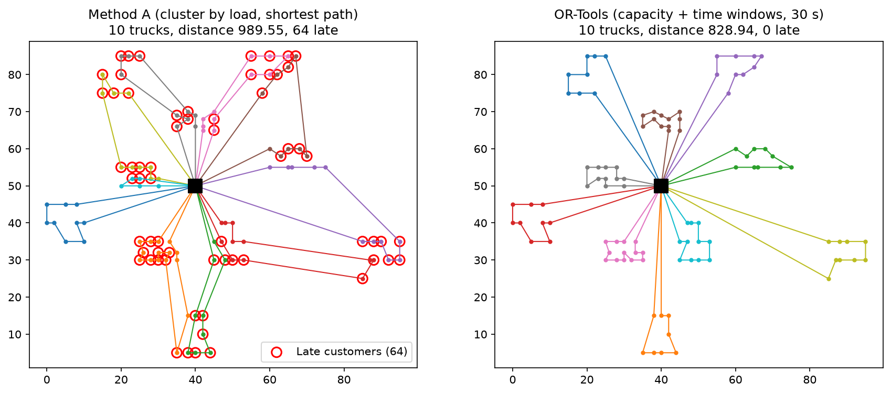

# VRPTW on Solomon C101: simple clustering vs OR-Tools

Independent project, Nov 2026.

## Why

During my internship I planned delivery routes by first splitting orders into trucks by load
("cluster by capacity"). That covers only the first step of route planning: it ignores
delivery time windows and does not optimise the route inside each truck.
This project takes the full problem - the **Vehicle Routing Problem with Time Windows (VRPTW)** -
on a public benchmark and compares that simple approach with a proper solver.

## Data

Solomon VRPTW benchmark, instance **C101** (100 customers, clustered locations), from the
SINTEF TOP page: <https://www.sintef.no/projectweb/top/vrptw/100-customers/>.

Each customer has x/y coordinates, demand, a time window `[ready_time, due_date]` and a
service time (90 for every customer in C101). There are up to 25 trucks of capacity 200, and
the depot is open from 0 to 1236. Distances are straight-line (Euclidean); travel time = distance.

The best known solution (SINTEF) is **10 trucks, total distance 828.94**. Solutions are ranked
by number of trucks first, then by distance.

## Methods

| Method | What it does |
|---|---|
| **A - cluster by load, shortest path** | Sort customers by angle around the depot (sweep) and fill trucks up to capacity 200. Inside each truck: nearest-neighbour route improved with 2-opt. Time windows are **not** used. |
| **A2 - cluster by load, time order** | Same trucks as A, but each truck visits customers in order of `ready_time`. Isolates whether lateness comes from the visiting order or from the clustering itself. |
| **B - OR-Tools** | Google OR-Tools routing solver with capacity and time-window constraints. A large fixed cost per truck makes it use fewer trucks first, then minimise distance. Guided local search, 30 s limit. |

All three are scored by the same checker (`evaluate.py`): the truck may wait if it arrives early;
arriving after `due_date` counts as a late customer.

## Results (C101)

| Method | Trucks | Distance | Gap vs best | Late customers | Trucks back after depot closes |
|---|---|---|---|---|---|
| A - load clustering, shortest path | 10 | 989.55 | +19.4% | 64 / 100 | 7 |
| A2 - load clustering, time order | 10 | 1414.01 | +70.6% | 34 / 100 | 4 |
| B - OR-Tools (30 s) | 10 | **828.94** | 0.0% | **0** | 0 |
| Best known (SINTEF) | 10 | 828.94 | - | 0 | - |

Method A runs in milliseconds; OR-Tools uses its full 30-second time limit.
Full table: `results/c101_comparison.csv`. Route maps: `figures/c101_routes.png`.



## What I learned

- **Capacity-only clustering is not enough when deliveries have time windows.** Method A uses the
  same number of trucks as the optimum, but 64 of 100 customers would be served late.
- **The problem is the clustering, not just the visiting order.** Re-ordering each truck by time
  window (A2) still leaves 34 customers late and makes the routes 70% longer. For example, one truck
  in Method A got 15 customers: 15 x 90 = 1350 minutes of service alone, longer than the depot's
  working day (1236). No visiting order can fix that.
- **Time windows have to be part of how trucks are formed.** OR-Tools decides trucks and order
  together and matches the best known solution (10 trucks, 828.94) on this instance.

## Limitations

- Only one instance (C101). Its customers are clustered and the time windows fit those clusters
  well, which makes it relatively easy for a solver.
- Method A is my re-implementation of the idea (sweep + capacity), not the exact internship code;
  the sweep starting angle is arbitrary and other clustering choices would give other numbers.
- OR-Tools works in integers, so distances are scaled by 10 and rounded inside the solver;
  the reported distances are recomputed in full precision by `evaluate.py`.
- Runtime depends on the machine.

## Next steps

- Run R101 (random locations) and RC101 (mixed), where the gap is likely to be larger.
- Try a time-aware clustering (e.g. cluster on location + time window) as a middle ground.

## How to run

```bash
python -m venv .venv          # Python 3.12 (OR-Tools has no wheel for 3.15 yet)
.venv\Scripts\Activate.ps1    # Windows PowerShell
pip install -r requirements.txt

python read_data.py        # check the data loads (101 rows incl. depot)
python plot_customers.py   # figures/c101_customers.png
python method_a.py         # Method A and A2 routes
python solve_ortools.py    # OR-Tools routes (~30 s)
python compare.py          # comparison table -> results/
python plot_routes.py      # figures/c101_routes.png
```

## Files

| File | Purpose |
|---|---|
| `read_data.py` | Read a Solomon instance into a pandas DataFrame |
| `evaluate.py` | Distance matrix and the shared solution checker |
| `method_a.py` | Method A / A2 (cluster by load, then route) |
| `solve_ortools.py` | Method B (OR-Tools VRPTW) |
| `compare.py` | Run all methods, save the comparison table and routes |
| `plot_customers.py`, `plot_routes.py` | Figures |

## Use of AI

I used an AI assistant (Claude) to help write the code. I ran every script myself, checked the
results against the best known solution, and can explain each step.
