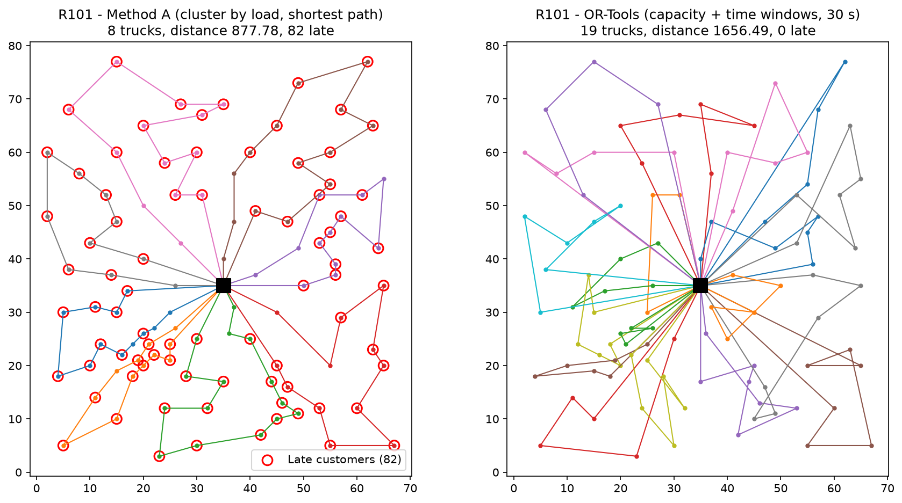
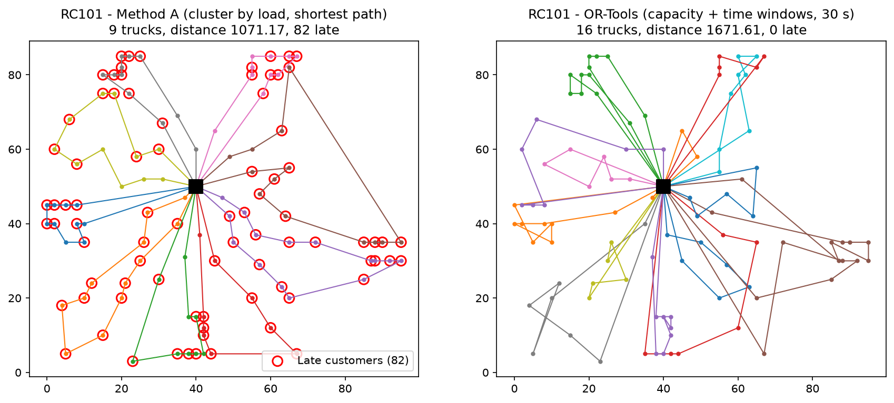

# VRPTW on Solomon C101, R101 and RC101: simple clustering vs OR-Tools

Independent project, Nov 2026.

## Why

During my internship I planned delivery routes by first splitting orders into trucks by load
("cluster by capacity"). That covers only the first step of route planning: it ignores
delivery time windows and does not optimise the route inside each truck.
This project takes the full problem - the **Vehicle Routing Problem with Time Windows (VRPTW)** -
on a public benchmark and compares that simple approach with a proper solver.

## Data

Solomon VRPTW benchmark, one instance from each of the three classes (100 customers each),
from the SINTEF TOP page: <https://www.sintef.no/projectweb/top/vrptw/100-customers/>.

| Instance | Customer locations | Depot open | Service time |
|---|---|---|---|
| **C101** | clustered | 0 - 1236 | 90 |
| **R101** | random | 0 - 230 | 10 |
| **RC101** | mix of clustered and random | 0 - 240 | 10 |

Each customer has x/y coordinates, demand, a time window `[ready_time, due_date]` and a
service time. There are up to 25 trucks of capacity 200. Distances are straight-line
(Euclidean); travel time = distance. R101 and RC101 have a much shorter working day and
tighter time windows than C101.

Best known solutions (SINTEF, checked 2026-11-28) are ranked by **number of trucks first, then
distance**: C101 10 trucks / 828.94, R101 19 / 1650.80, RC101 14 / 1696.95.

## Methods

| Method | What it does |
|---|---|
| **A - cluster by load, shortest path** | Sort customers by angle around the depot (sweep) and fill trucks up to capacity 200. Inside each truck: nearest-neighbour route improved with 2-opt. Time windows are **not** used. |
| **A2 - cluster by load, time order** | Same trucks as A, but each truck visits customers in order of `ready_time`. Isolates whether lateness comes from the visiting order or from the clustering itself. |
| **B - OR-Tools** | Google OR-Tools routing solver with capacity and time-window constraints. A large fixed cost per truck makes it use fewer trucks first, then minimise distance. First solution by parallel cheapest insertion, then guided local search, 30 s limit. |

All three are scored by the same checker (`evaluate.py`): the truck may wait if it arrives early;
arriving after `due_date` counts as a late customer.

## Results

| Instance | Method | Trucks | Distance | Late customers | Trucks back after depot closes |
|---|---|---|---|---|---|
| C101 | A - load clustering, shortest path | 10 | 989.55 | 64 / 100 | 7 |
| C101 | A2 - load clustering, time order | 10 | 1414.01 | 34 / 100 | 4 |
| C101 | B - OR-Tools (30 s) | 10 | **828.94** | **0** | 0 |
| C101 | Best known (SINTEF) | 10 | 828.94 | 0 | - |
| R101 | A - load clustering, shortest path | 8 | 877.78 | 82 / 100 | 8 |
| R101 | A2 - load clustering, time order | 8 | 1637.69 | 89 / 100 | 8 |
| R101 | B - OR-Tools (30 s) | **19** | **1656.49** | **0** | 0 |
| R101 | Best known (SINTEF) | 19 | 1650.80 | 0 | - |
| RC101 | A - load clustering, shortest path | 9 | 1071.17 | 82 / 100 | 9 |
| RC101 | A2 - load clustering, time order | 9 | 2017.35 | 65 / 100 | 8 |
| RC101 | B - OR-Tools (30 s) | **16** | 1671.61 | **0** | 0 |
| RC101 | Best known (SINTEF) | 14 | 1696.95 | 0 | - |

OR-Tools against the best known solution:

- **C101:** same trucks and distance (gap 0.0%).
- **R101:** same number of trucks, distance 0.3% longer.
- **RC101:** 2 more trucks than the best known solution. Its distance is shorter, but because
  solutions are ranked by trucks first, this is a worse solution, not a better one; no distance
  gap is reported when the truck counts differ.

Method A runs in milliseconds; OR-Tools uses its full 30-second time limit.
Running the comparison twice gave identical routes.
Full tables: `results/<instance>_comparison.csv` and `results/summary.csv`.
Route maps: `figures/<instance>_routes.png`.





## What I learned

- **Capacity-only clustering is not enough when deliveries have time windows.** On C101 Method A
  uses the same number of trucks as the optimum, but 64 of 100 customers would be served late.
- **With tight time windows, load alone badly underestimates the fleet.** On R101 and RC101 the
  goods fit into 8 and 9 trucks, but every one of those trucks would return after the depot closes
  and 82 of 100 customers would be late. A plan that serves everyone on time needs 19 trucks on
  R101 and at least 14 on RC101 - about twice as many.
- **The problem is the clustering, not just the visiting order.** Re-ordering each truck by time
  window (A2) still leaves 34 (C101), 89 (R101) and 65 (RC101) customers late. On C101, one
  truck in Method A got 15 customers: 15 x 90 = 1350 minutes of service alone, longer than the
  depot's working day (1236). No visiting order can fix that.
- **Time windows have to be part of how trucks are formed.** OR-Tools decides trucks and order
  together: it matches the best known solution on C101, is within 0.3% on R101, and on RC101
  reaches a feasible plan that is 2 trucks short of the best known one within 30 seconds.
- **The solver's start matters on tight instances.** The default "path cheapest arc" start
  (extend each route with the nearest next stop) could not build any feasible solution on R101
  or RC101 within the time limit; starting from cheapest insertion could, and gives the same
  result on C101.

## Limitations

- One instance per class, one run each with a 30-second limit. RC101 is not solved to the best
  known number of trucks; a longer limit or a different search may close that gap.
- C101 is relatively easy: its customers are clustered and the time windows fit those clusters.
- Method A is my re-implementation of the idea (sweep + capacity), not the exact internship code;
  the sweep starting angle is arbitrary and other clustering choices would give other numbers.
- OR-Tools works in integers, so distances are scaled by 10 and rounded inside the solver;
  the reported distances are recomputed in full precision by `evaluate.py`.
- Runtime depends on the machine.

## Next steps

- Give OR-Tools longer on RC101 and see whether it reaches 14 trucks.
- Try a time-aware clustering (e.g. cluster on location + time window) as a middle ground.
- Run all 56 Solomon instances.

## How to run

```bash
python -m venv .venv          # Python 3.12 (OR-Tools has no wheel for 3.15 yet)
.venv\Scripts\Activate.ps1    # Windows PowerShell
pip install -r requirements.txt

python read_data.py        # check the data loads (101 rows incl. depot)
python plot_customers.py   # figures/c101_customers.png
python method_a.py         # Method A and A2 routes on C101
python solve_ortools.py    # OR-Tools routes on C101 (~30 s)
python compare.py          # all three instances (~90 s) -> results/
python compare.py r101     # or just one instance
python plot_routes.py      # figures/<instance>_routes.png
```

## Files

| File | Purpose |
|---|---|
| `read_data.py` | Read a Solomon instance into a pandas DataFrame |
| `evaluate.py` | Distance matrix and the shared solution checker |
| `method_a.py` | Method A / A2 (cluster by load, then route) |
| `solve_ortools.py` | Method B (OR-Tools VRPTW) |
| `compare.py` | Run all methods on one or more instances, save comparison tables and routes |
| `plot_customers.py`, `plot_routes.py` | Figures |

## Use of AI

I used an AI assistant (Claude) to help write the code. I ran every script myself, checked the
results against the best known solutions, and can explain each step.
